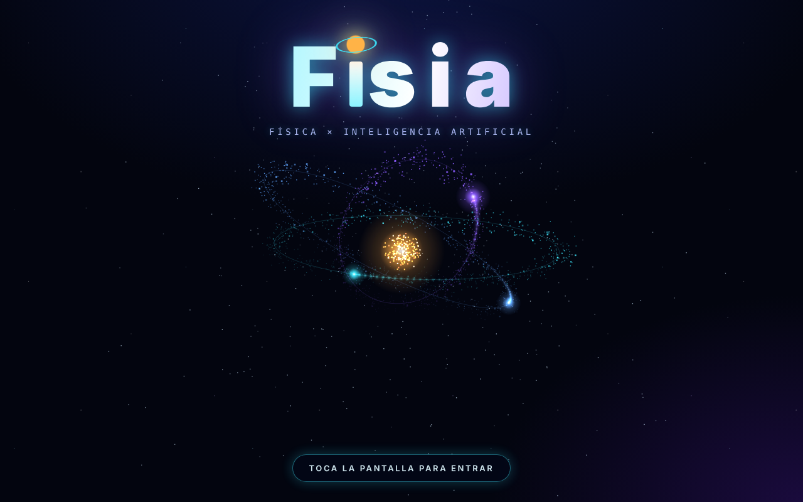
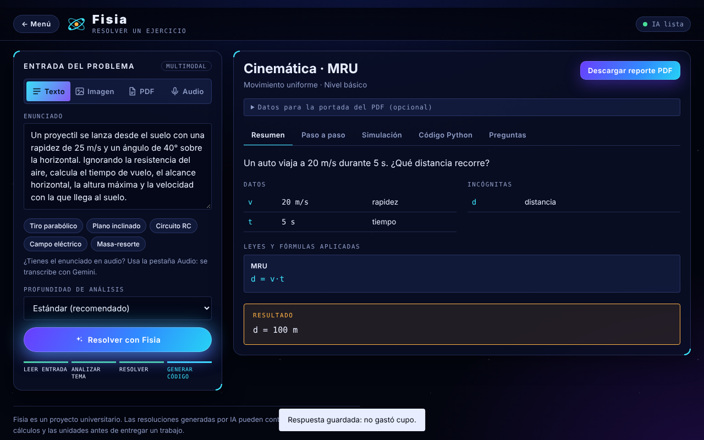
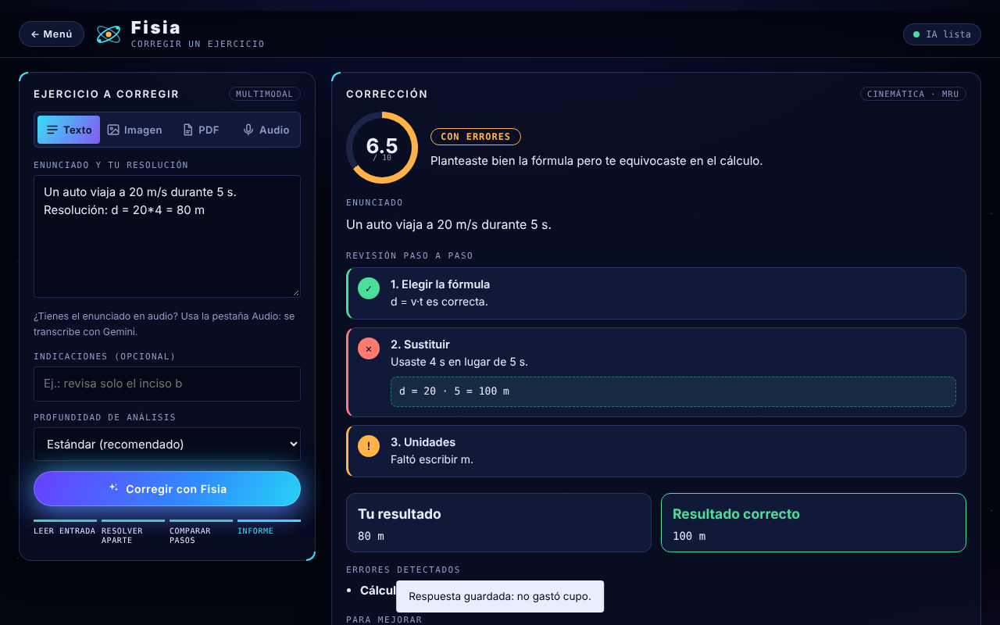
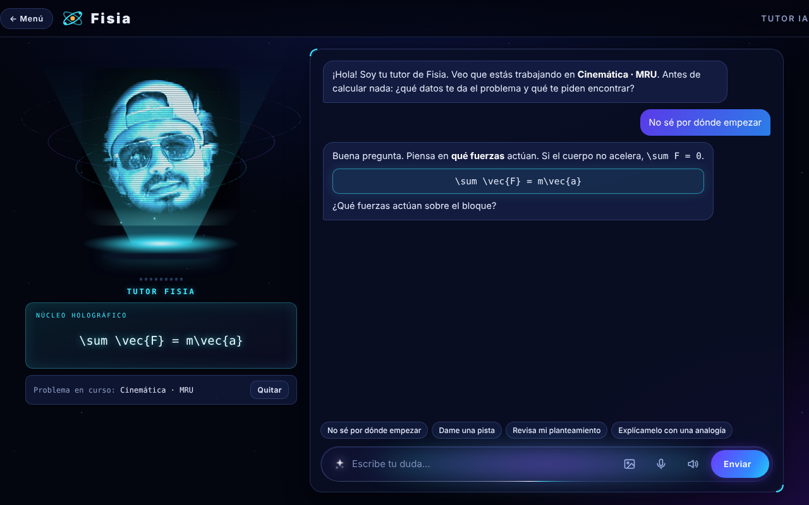

# FisIA

**Física + Inteligencia Artificial.** Aplicación web que corre en tu propia computadora (servidor local en Python) y resuelve, corrige y explica problemas de física con Google Gemini, usando una clave gratuita.

> Proyecto universitario de Física — Universidad Nacional de las Ciencias «Dr. Humberto Fernández Morán».



## Características

| Sección | Qué hace |
| --- | --- |
| **Resolver un ejercicio** | Recibe texto, imagen, PDF o audio. Identifica el tema, resume datos, incógnitas y leyes, resuelve paso a paso, dibuja una simulación de muestra, genera un **reporte PDF** descargable y un **programa Python** editable (Matplotlib, Plotly, Pygame o Manim). |
| **Corregir uno ya hecho** | Subes tu resolución; marca qué pasos están bien, dónde está el error, cómo arreglarlo y propone una nota. |
| **Tutor IA** | Profesor socrático con avatar holográfico: guía con preguntas en lugar de dar la respuesta final y proyecta la fórmula clave. |

Además: interfaz con átomo animado, diseño responsivo (PC y teléfono), caché de respuestas, límite de peticiones y selección automática de modelo para no saturar la API gratuita.

| Menú | Resolución |
| --- | --- |
|  |  |
|  |  |

## Inicio rápido

Necesitas Python 3.10+ y una clave gratuita de Gemini (https://aistudio.google.com/apikey, sin tarjeta).

```bash
git clone https://github.com/TU_USUARIO/fisia.git
cd fisia
python -m venv venv
venv\Scripts\activate            # Windows
source venv/bin/activate         # macOS / Linux
pip install -r requirements.txt
cp .env.example .env             # Windows: copy .env.example .env
# edita .env y pega tu GEMINI_API_KEY
python app.py
```

Se abre http://127.0.0.1:5000. También puedes hacer doble clic en `iniciar.bat` (Windows) o `iniciar.command` (macOS/Linux).

Guía completa y solución de problemas: [docs/INSTALACION.md](docs/INSTALACION.md).

## Documentación

- [Instalación y uso](docs/INSTALACION.md)
- [Arquitectura](docs/ARQUITECTURA.md)
- [Cómo subir este proyecto a GitHub](docs/GUIA_GITHUB.md)
- [Registro de cambios](CHANGELOG.md)

## Pruebas

```bash
python tests/test_servidor.py
python tests/test_modelos.py
python tests/test_gemini4.py
```

Corren contra un Gemini simulado: no necesitan internet ni clave.

## Seguridad

- La clave vive solo en `.env`, que `.gitignore` excluye. **Nunca subas `.env` a GitHub.**
- En el plan gratuito, Google puede usar lo que envías para mejorar sus productos: no subas datos personales.
- Quien abra tu enlace (si lo compartes en red o por túnel) usa el cupo de tu clave.

## Tecnologías

Python · Flask · Pillow · Google Gemini (API REST) · HTML/CSS/JavaScript sin framework · jsPDF · pdf.js · KaTeX

## Autores

- Anderson Sánchez
- Gabriela Rivas
- Christian Contreras
- Andrés Guerra

Universidad Nacional de las Ciencias «Dr. Humberto Fernández Morán». Proyecto de la asignatura de Física.

## Licencia

MIT. Ver [LICENSE](LICENSE).

> Las resoluciones generadas por IA pueden contener errores: revisa cálculos y unidades antes de entregar un trabajo.
